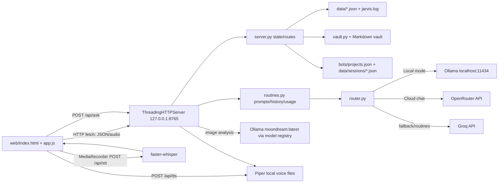
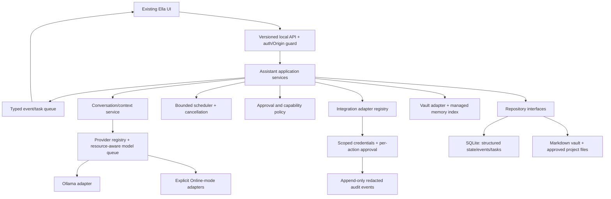

# Ella architecture

**Audit date:** 2026-11-04. The first diagram is the checked-in implementation; the second is a proposed direction, not implemented code.

## Current modules and responsibilities

- `server.py`: HTTP routing, runtime defaults, project prompt/session coordination, state aggregation, backup/restore, vision call and startup initialization.
- `permissions.py`: L1–L4 permission decisions. It does not perform the action. L4 never auto-executes.
- `tasks.py`: local task plans, per-step permission checks, and `data/tasks.json` updates through `locked_update`.
- `context_manager.py`: local-first routing decision for the existing brain mode. It does not call a provider.
- `model_registry.py`: configured chat/vision capabilities. Vision id is `moondream:latest`. No prices and no model load.
- `router.py`: `.env` parsing, Ollama/OpenRouter/Groq HTTP adapters, provider cascade and basic usage extraction. Unknown modes stay on Ollama.
- `routines.py`: system prompt construction, ephemeral main-chat history, check-in/adapt/outbox routines, usage ledger, quota, identity/context text filters.
- `store.py`: JSON serialization, atomic replace, activity/log files, history snapshots and a filesystem lock for selected routines.
- `stt.py`: lazy faster-whisper loading, CUDA/CPU fallback, temporary audio handling and transcription.
- `tts.py`: lazy Piper loading, optional warmup and WAV synthesis.
- `projects.py`: bounded shallow scan of hard-coded local directories for project windows.
- `vault.py`: Markdown vault time handling, graph inventory, name matching and daily note append.
- `scout.py`: external OpenRouter model catalog fetch/filter.
- `ella.py`: optional pywebview wrapper around the loopback server.
- `web/`: vanilla browser interface, fetch API client, audio capture/playback, ring and canvas UI, windows and panels.

## Implemented request/data flow

The web layer polls state via fetch (not push). The screenshot path calls Ollama directly rather than provider routing. No runtime was started to validate live behavior.

## Main data flows and boundaries

1. **Chat:** `/api/ask` is serialized through a process-wide `RoutineLock`. Main chat calls `_messages()` with at most ten prior turns in process memory; context disappears on restart. The returned answer is added to activity, and provider usage is written to JSON.
2. **Project chat:** project config supplies a prompt and selected reference text. The route appends messages to its session JSON, but the project messages are not passed into the model. `_messages()` can append the global chat history even when `project_prompt` is supplied. This is a context-isolation defect (BUG-001).
  `build_project_prompt()` loads every profile, brain file and skill listed on the selected project card; it does not select one skill based on the current user request. Skill lookup assumes `skills/<name>/SKILL.md`; missing entries silently yield no content. `SKILL_MAP` is exposed in state for the UI, not used as a dynamic loader. `.cursor/skills/` is not read by the server.
3. **Voice:** browser records audio, sends it to STT, sends transcript to chat, then optionally requests Piper WAV. STT accepts one hard-coded English language. Piper model/voice loads from local path.
4. **Vault/memory:** Markdown is the human-maintained knowledge base; JSON facts/profile are separate small runtime data. Vault graph is a list of note filenames/folders rather than relationship graph. No vector or semantic index exists.
5. **Background work:** missed check-in launches a daemon thread at server start. Check-in/adapt/scout/outbox routes are synchronous. Phase 2 adds a durable task record (`data/tasks.json`) for plans and unfinished steps. It is not a scheduler, and it does not run external actions.
6. **Persistence:** JSON files live in `data/`, ignored by Git. Some writes use atomic replacement but read-modify-write cycles are not coordinated across threads. Vault append uses direct file writes.

## Current frontend contract

The existing interface is in `web/index.html`, `web/app.js`, and `web/styles.css`. It contains a ring/chat experience, navigation, canvas ambient/brain drawings, project launcher/windows, model/mode controls, voice and usage surfaces. Browser-to-server communication is `fetch()` against same-origin `/api/*`. There is no second frontend, SSE, WebSocket, typed API schema or generated client. Preserve these visuals and behavior when extending; do not generate a competing frontend.

## Proposed evolution (not implemented)

Introduce seams without a wholesale rewrite: route handlers → application services → adapters; explicit conversation/session IDs; provider and model registry; cancellable queued inference; permission-checked tools; event/task persistence; integration adapters; read/write repositories; and a frontend API layer with schema/versioning. Add SQLite only after data ownership/migrations/backups are decided. Keep the Markdown vault and existing project windows as first-class sources during any migration.

## Constraints and open questions

- Confirm machine-specific paths, Python environment, Ollama model inventory and available VRAM before choosing defaults.
- Runtime project windows use `bots/projects.json`; the separate Ella/Jarvis identity JSON files are not the project registry, while `CLAUDE.md` still identifies the assistant as Jarvis. Project profile/path mappings are incomplete and should not be assumed to provide file access.
- Define whether “Cloud mode” is strictly cloud or a fallback-enabled hybrid mode; current code is hybrid.
- Specify cancellation semantics, session ownership, retention limits, schema migration and recovery before adding more persistence.
- Define the minimal trustworthy Windows security boundary; loopback binding alone is not authorization.
- Keep hardware and model scheduling decisions evidence-based; no GPU monitoring is currently implemented.
